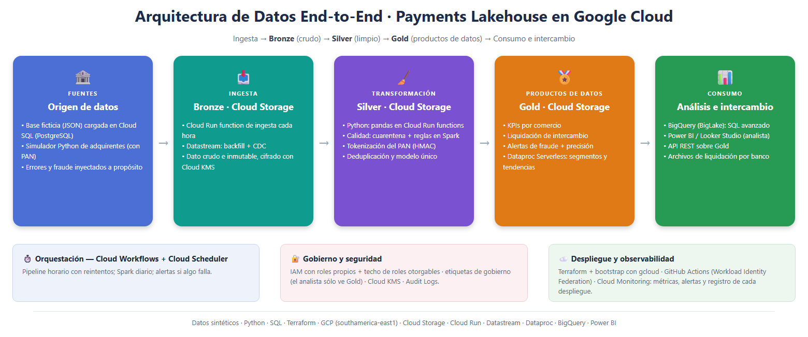
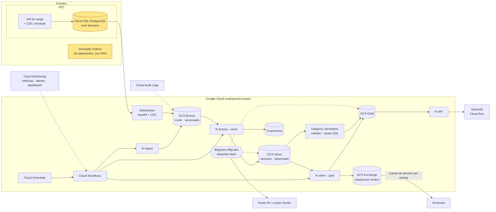

# Payments Lakehouse en Google Cloud · Bronze / Silver / Gold



Plataforma de datos de punta a punta para una **red de pagos con tarjeta**, construida en **Google Cloud**.
Trabaja con dos fuentes de datos, ambas ficticias:

1. **Una base de datos ficticia** ([`sample_data/mastercard_db_ficticia.json`](sample_data/mastercard_db_ficticia.json):
   bancos emisores, comercios, tarjetas y 1.500 transacciones de septiembre). Se carga en un **Cloud SQL para
   PostgreSQL** que hace de "core bancario" y se replica a Cloud Storage con **Datastream**, que además captura cada
   cambio nuevo (**CDC**).
2. **Un simulador en Python** ([`generator.py`](src/payments_lake/generator.py)) que imita los archivos de
   autorizaciones que enviaría un adquirente, con errores de calidad y patrones de fraude inyectados a propósito.

Las ordena en tres capas sobre Cloud Storage siguiendo la arquitectura medallion:

- **Bronze** guarda el dato tal como llegó, cifrado con una llave propia (CMEK) e inmutable (versionado).
- **Silver** lo limpia, valida y deduplica, manda a cuarentena lo que no cumple las reglas y **tokeniza el número de
  tarjeta**: ningún analista ve un PAN.
- **Gold** produce los productos de datos: KPIs por comercio, la **liquidación de intercambio** entre bancos y
  **alertas de fraude** con la precisión de cada regla medida contra fraudes confirmados.

Se consume con **BigQuery** (tablas BigLake sobre los Parquet), **Power BI** o **Looker Studio**, una **API REST** y
archivos de liquidación que cada banco emisor descarga de **su** carpeta. Todo es **infraestructura como código**
(Terraform + un bootstrap con gcloud), con **IAM de mínimo privilegio con roles propios**, gobierno de datos por
**etiquetas** y **CI/CD en GitHub Actions con Workload Identity Federation** (sin llaves JSON).

> ⚠️ Todos los datos son **sintéticos**: bancos, comercios, tarjetas, tipos de cambio y tasas de intercambio son inventados.

## Cobertura técnica

| Tema | Dónde se ve en el proyecto |
|---|---|
| **Cloud Storage** | 6 buckets (uno por capa), CMEK, versionado, ciclo de vida a Coldline, managed folders por emisor — [`storage.tf`](infra/platform/storage.tf) |
| **Cloud Run functions** | 4 functions: ingesta, bronze→silver, silver→gold, API — [`functions.tf`](infra/platform/functions.tf), [`handlers.py`](src/payments_lake/handlers.py) |
| **Datastream + Cloud SQL** | backfill + CDC de PostgreSQL a Bronze en JSONL, TLS verificado, IPs de Datastream autorizadas — [`datastream.tf`](infra/platform/datastream.tf), [`core_db.tf`](infra/platform/core_db.tf), adaptador en [`silver.py`](src/payments_lake/silver.py) |
| **Dataproc Serverless** | job PySpark diario: reglas de calidad sobre Silver + segmentos y tendencias en Gold — [`gold_card_analytics.py`](dataproc/jobs/gold_card_analytics.py) |
| **BigQuery** | 4 datasets (3 capas + vistas para BI), conexión BigLake, tablas particionadas Hive, 12 consultas con tope de 1 GB — [`bigquery.tf`](infra/platform/bigquery.tf), [`sql/`](sql/) |
| **Cloud Workflows / Scheduler** | pipeline con reintentos y backoff; Spark diario — [`orchestration.tf`](infra/platform/orchestration.tf), [`workflows/`](infra/platform/workflows/) |
| **IAM** | 16 identidades (15 de la plataforma + la de despliegue), 17 roles propios, techo de roles otorgables, 33 pruebas reales — [`iam.tf`](infra/platform/iam.tf), [`docs/iam.md`](docs/iam.md) |
| **Gobierno** | etiquetas `layer` / `sensitivity` en los datasets; el analista sólo ve Gold — [`bigquery.tf`](infra/platform/bigquery.tf) |
| **Seguridad** | Cloud KMS, Secret Manager, Audit Logs con sink a bucket de auditoría y alertas — [`audit.tf`](infra/platform/audit.tf) |
| **Observabilidad** | métricas de negocio y calidad, alertas, dashboard, registro de cada despliegue — [`observability.tf`](infra/platform/observability.tf), [`docs/observabilidad-despliegues.md`](docs/observabilidad-despliegues.md) |
| **SQL avanzado** | ventanas, z-score, `APPROX_QUANTILES`, cohortes, `ROLLUP`/`GROUPING`, `COUNTIF` — [`sql/advanced/`](sql/advanced/); Spark SQL en Dataproc |
| **Python / Shell** | paquete `payments_lake`, 44 tests; scripts PowerShell/bash en [`infra/command/`](infra/command/) |
| **CI/CD** | tests (también con las versiones exactas de las functions), `terraform validate`, YAML de Workflows, ShellCheck, deploy con WIF |
| **BI** | Power BI con el conector de BigQuery ([`docs/powerbi.md`](docs/powerbi.md)) y Looker Studio ([`docs/looker-studio.md`](docs/looker-studio.md)) |

## Verificado en Google Cloud

Desplegado y probado en un proyecto real (southamerica-east1, 26-10-2026). Cada prueba se ejecutó contra los
recursos desplegados:

| Prueba | Resultado |
|---|---|
| Bootstrap con gcloud + despliegue con Terraform (~190 recursos) | ✅ |
| Workflow del pipeline: Ingest → Bronze → Silver → Gold | ✅ `SUCCEEDED` en ~2 min |
| Datastream backfill + CDC desde Cloud SQL (TLS verificado) | ✅ 1.575 transacciones (1.500 + 75 nuevas por CDC), cambios tardíos aplicados |
| Simulador → Silver | ✅ 2.036 recibidos, 1.978 válidos, 50 a cuarentena, 8 duplicados |
| Dataproc Serverless (reglas de calidad + Spark SQL) | ✅ `SUCCEEDED`, 11/11 reglas en `PASS` |
| BigQuery: 12 consultas | ✅ |
| Gobierno por etiquetas: el analista consulta Gold y **no** Silver ni Bronze | ✅ 8 permitidas / 4 denegadas |
| Intercambio B2B: el emisor EM001 lee y lista su carpeta, **no** la de EM005 | ✅ |
| API de Gold: 5 rutas, `401` sin API key | ✅ |
| Dashboard web en Cloud Run: sin contraseña no muestra datos; con ella, los KPIs de Gold | ✅ |
| IAM: 33 pruebas reales con impersonación | ✅ |
| Registro de cada despliegue en Cloud Logging + GCS | ✅ incluida la causa de cada fallo |

Los 18 problemas que aparecieron al desplegar por primera vez, con su causa y su corrección, están en
[docs/antes-de-desplegar.md](docs/antes-de-desplegar.md#problemas-que-ya-aparecieron).

## Arquitectura

Diagrama editable en draw.io: [`docs/img/arquitectura.drawio`](docs/img/arquitectura.drawio).



### Capas

| Capa | Bucket | Contenido | Quién accede |
|---|---|---|---|
| Bronze | `<proyecto>-bronze` | `transactions/` (simulador), `datastream/core_<tabla>/` (réplica CDC), `core_snapshot/` (extracto JSON) | ingest, Datastream y bronze→silver. **Ningún humano** |
| Silver | `<proyecto>-silver` | `transactions/source_system=…/txn_date=…`, `quarantine/`, `dq_source_reconciliation/`, `dim_*` | pipeline; analista de riesgo vía BigLake |
| Gold | `<proyecto>-gold` | KPIs, liquidación, alertas y desempeño de reglas de fraude, corredores, segmentos y tendencias (Spark), resultados de calidad | API, analistas vía BigLake |
| Exchange | `<proyecto>-exchange` | `outbound/issuer_id=…/settlement_date=…/settlement.csv + _manifest.json` | cada emisor, sólo su carpeta administrada |

## Qué hace cada capa

- **Ingesta multi-fuente**: el simulador de adquirentes (con errores inyectados a propósito) y el **core bancario**, que
  llega por **Datastream (CDC)** o, si el CDC está apagado, como extracto JSON ([`sample_data/`](sample_data/)).
- **Silver**: esquema canónico único, tipado, deduplicación, 10+ reglas de calidad, **cuarentena** con motivo,
  enriquecimiento. El PAN se **tokeniza (HMAC-SHA256)** con un secreto de Secret Manager y nunca sale de Bronze en
  claro; la cuarentena lo enmascara (`510510******1234`). Los totales que declara el core se **reconcilian** contra Silver.
- **Gold**: KPIs por comercio, **liquidación de intercambio emisor↔adquirente**, alertas de fraude (5 reglas) y su
  **precision/recall contra fraudes confirmados**, corredores transfronterizos; segmentación de tarjetas, tendencias
  y **resultados de calidad de datos** en Spark.
- **Intercambio de datos**: archivos de liquidación por emisor con manifiesto (SHA-256, totales), una cuenta de
  servicio por emisor con acceso sólo a su carpeta, y API REST sobre Gold.

## Estructura

```
src/                    # main.py + payments_lake/: el mismo código en local y en Cloud Run functions
dataproc/jobs/          # job PySpark (calidad de datos + Spark SQL)
scripts/                # carga y CDC del core, consultas, registro de despliegues, marcadores de tablas
sample_data/            # extracto core ficticio
sql/ · sql/advanced/    # consultas de BigQuery (GoogleSQL)
infra/bootstrap/        # gcloud: proyecto, APIs, estado, cuenta de despliegue con techo, WIF, presupuesto
infra/platform/         # Terraform: el lakehouse completo (iam.tf concentra todas las identidades)
infra/command/          # comandos de cada actualización: deploy · check_iam · destroy
dashboard/              # Streamlit + despliegue a Cloud Run
docs/                   # antes de desplegar, IAM, observabilidad de despliegues, Power BI, Looker Studio
tests/                  # 44 tests
```

## 1. Ejecutar en local (sin GCP)

```powershell
python -m venv .venv; .venv\Scripts\activate
pip install -r requirements-dev.txt
pytest -q
$env:PYTHONPATH="src"; python -m payments_lake.pipeline demo --days 3
pip install -r dashboard/requirements.txt; streamlit run dashboard/app.py
```

## 2. Desplegar en Google Cloud

> **Primera vez:** [docs/antes-de-desplegar.md](docs/antes-de-desplegar.md) (requisitos, credenciales, costos y los
> problemas que aparecieron en el primer despliegue).

```powershell
gcloud auth login; gcloud auth application-default login
./infra/bootstrap/bootstrap.ps1 -BillingAccount <cuenta> -AlertEmail tu@correo.com   # una vez
./infra/command/deploy.ps1 -RunPipeline        # cada cambio: tests → plan → apply → pipeline → check_iam
python scripts/run_queries.py --project <proyecto>                                    # las 12 consultas
./infra/command/destroy.ps1 -StopCdc           # apagar lo que cobra por hora
./infra/command/destroy.ps1                    # al terminar
```

Después, cada push a `main` lo despliega **GitHub Actions** con Workload Identity Federation. El bootstrap carga las
variables del repositorio (`GCP_PROJECT_ID`, `GCP_WIF_PROVIDER`, `GCP_DEPLOY_SA`, `TF_STATE_BUCKET`…).

### Costos

Una semana con todo encendido ronda **USD 5–8** (Cloud SQL `db-f1-micro` + VM `e2-micro` son la mayor parte; el
resto son centavos). El detalle está en [antes-de-desplegar.md](docs/antes-de-desplegar.md#costos).

## Decisiones de diseño

- **Cloud Run functions + pandas para el pipeline horario, Dataproc Serverless para la analítica diaria**: con este
  volumen las functions son más baratas y simples; Spark muestra el camino de escala sobre la misma capa Silver.
- **BigLake para Silver/Gold, tabla externa común para Bronze**: con BigLake la conexión lee los archivos y el
  analista no necesita permisos sobre los buckets. Bronze no usa la conexión a propósito: sólo
  la consulta quien ya puede leer el bucket, y ningún humano puede.
- **Gobierno por etiquetas**: los permisos de lectura son condiciones sobre la etiqueta `layer` del dataset; una tabla
  nueva de Gold queda disponible sin tocar IAM.
- **Roles propios en vez de predefinidos**: `roles/dataproc.worker`, por ejemplo, da lectura, escritura y cambio de IAM
  sobre todos los objetos del proyecto. El rol propio es el mismo sin `storage.*`.
- **Techo de roles otorgables** en vez de permissions boundary: la cuenta de despliegue sólo puede otorgar los roles de
  [`grantable_roles.txt`](infra/bootstrap/grantable_roles.txt), condición que IAM evalúa en cada cambio.
- **Datastream tiene prioridad sobre el extracto JSON**: ambas son la misma fuente (`source_system=core`) por distinto
  canal; Silver aplica los cambios CDC (INSERT/UPDATE/DELETE, gana el último `source_timestamp`, desempata el LSN).
- **Idempotencia**: Silver y Gold se recalculan por ventana reemplazando sólo las particiones afectadas; reprocesar da
  el mismo resultado (tests).
- **Pruebas de IAM reales**: Policy Troubleshooter no evalúa condiciones por prefijo de objeto; `check_iam.ps1` actúa
  como cada identidad contra los recursos desplegados.
- **Las reglas de fraude tienen baja precisión a propósito**: `fraud_rule_performance` permite medirlas y calibrarlas.
